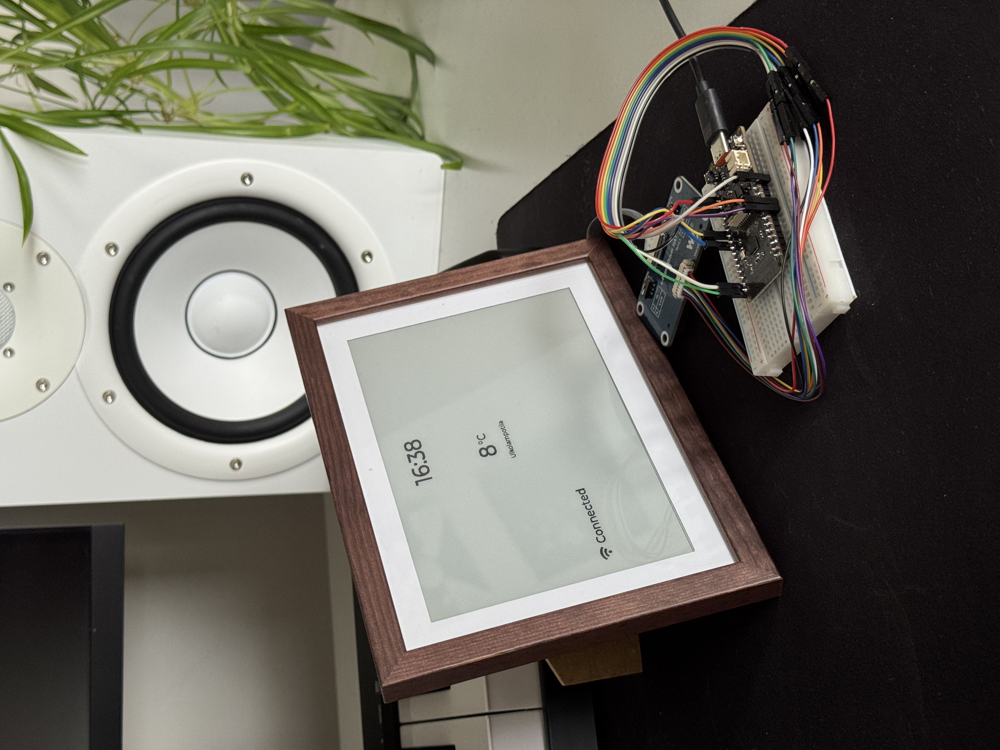

# Smart Dashboard

ESP32 + E-ink smart screen project

> Very much WIP..

## Preview




## Features

- Custom display driver
- LVGL
- Feature 3
- Feature 4
- Feature 5

## Future Features / Backlog

### Qt E-Ink Dashboard Simulator

- Enables fast UI and layout iteration on a PC without repeatedly building and flashing the ESP32.
- Reuses the dashboard state and LVGL rendering flow so the simulator mirrors the 800×480, 1-bit e-ink output.
- Provides editable test data for time, weather, and Nysse departures, including edge-case scenarios that are difficult to reproduce with live APIs.
- Visualizes framebuffer differences and dirty regions to develop and debug full versus partial refresh behavior before testing on hardware.

## Hardware

| Part | Notes |
| --- | --- |
| MCU | Firebeetle 2 ESP32-C6 |
| Display | Waveshare 7.5 inch e-ink |
| Power | USB |
| Other | TBA |
|

## LVGL Configuration

This project uses the ESP-IDF managed LVGL component.

LVGL configuration done through ESP-IDF Kconfig settings `sdkconfig` / `menuconfig`:

Configure everything LVGL related here

```bash
idf.py menuconfig

-> Component config -> LVGL configuration
```
